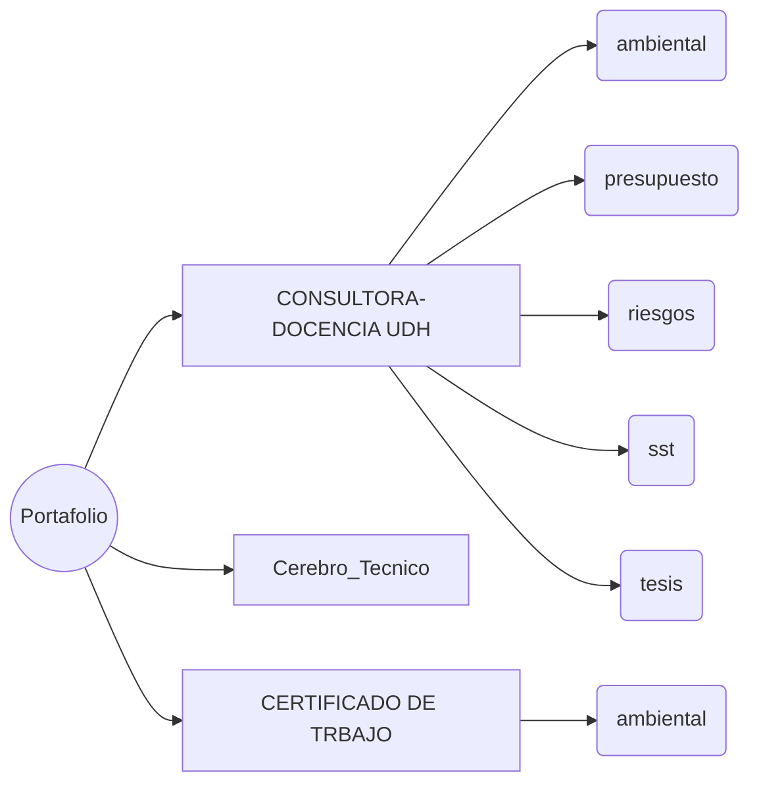

# 🗂️ Briefing del portafolio — 02/09/2026

Raíz analizada: `C:\Users\DESKTOP\OneDrive\Desktop` · 12 frentes · activo = tocado en los últimos 14 días.

## ⚠️ Necesita atención

| Nivel | Proyecto | Qué pasa | Acción |
|---|---|---|---|
| 🔴 ALTO | **CONSULTORA-DOCENCIA UDH** | Memoria desactualizada: memoria.md es 93 días más antigua que el último archivo modificado (Plan de Tesis - Antonio Teodoro Valdivia Martel 2026.docx). | Reconstruir memoria.md: el agente arranca cada sesión con un estado que ya no es real. |
| 🔴 ALTO | **TESIS** | Observaciones por absolver: 7 documento(s) sin autoría propia detectada (1 sin verificar por formato, revisar a mano). El más reciente, «TESIS_CORREGIDA_v3_OBSERVACIONES_LEVANTADAS.docx», hace 84 días. | Abrir y confirmar si es un pliego recibido. Si lo emite una entidad (GORE, OSCE, MINAM, SENACE), el plazo es legal y vence. |
| 🟡 MEDIO | **CONSULTORA-DOCENCIA UDH** | Observaciones por absolver: 36 documento(s) sin autoría propia detectada (19 sin verificar por formato, revisar a mano). El más reciente, «INFORME_OBSERVACIONES_LINEA_BASE.docx», hace 1 días. | Abrir y confirmar si es un pliego recibido. Si lo emite una entidad (GORE, OSCE, MINAM, SENACE), el plazo es legal y vence. |
| 🟢 BAJO | **CONSULTORA-DOCENCIA UDH** | Informes propios emitidos: 9 informe(s) de opinión técnica firmados por el equipo (no son deuda). | Ninguna. Se listan solo para no confundirlos con pliegos recibidos. |

## 🔵 Frentes activos (últimos 14 días)

| Proyecto | Última actividad | Último archivo | Áreas | Archivos |
|---|---|---|---|---|
| **CONSULTORA-DOCENCIA UDH** | 2026-09-02 | `Plan de Tesis - Antonio Teodoro Valdivia M` | ambiental, presupuesto, riesgos, sst, tesis | 2211 |
| **Cerebro_Tecnico** | 2026-08-31 | `Briefing_Portafolio.md` | — | 1 |
| **CERTIFICADO DE TRBAJO** | 2026-08-26 | `CONSTANCIAS PERFECTA.pdf` | ambiental | 4 |

## 💤 En pausa

| Proyecto | Última actividad | Áreas |
|---|---|---|
| TESIS | 2026-08-14 | ambiental, riesgos, sst, tesis |
| PORTUGUES | 2026-08-12 | — |
| CLASES 2026 II | 2026-08-11 | ambiental |
| SST | 2026-07-27 | ambiental, sst |
| SEGURIDAD Y SALUD EN EL TRABAJO | 2026-06-09 | sst |
| PORTUGUEZ | 2026-05-27 | — |
| 03. RIESGOS Y SEGURIDAD EN LA CONSTRUCCION | 2026-01-03 | riesgos, sst |
| 02. EVALUACION DE IMPACTO AMBIENTAL | 2026-01-03 | ambiental |
| ECONOMIA AMBIENTAL | 2025-11-28 | ambiental |

## 🕸️ Mapa del portafolio

---

*Generado por `dashboard-proyectos-live` (modo operador). Solo lectura: no modifica archivos de proyecto.*