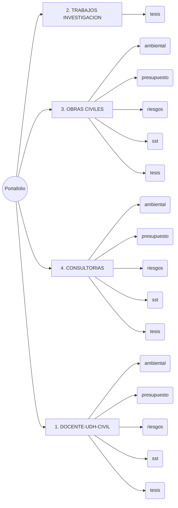

# 🗂️ Briefing del portafolio — 31/08/2026

Raíz analizada: `C:\Users\DESKTOP\OneDrive\Desktop\CONSULTORA-DOCENCIA UDH` · 4 frentes · activo = tocado en los últimos 14 días.

## ⚠️ Necesita atención

| Nivel | Proyecto | Qué pasa | Acción |
|---|---|---|---|
| 🔴 ALTO | **1. DOCENTE-UDH-CIVIL** | Memoria desactualizada: memoria.md es 49 días más antigua que el último archivo modificado (CARTA 15-MAOT-UDH.pdf). | Reconstruir memoria.md: el agente arranca cada sesión con un estado que ya no es real. |
| 🔴 ALTO | **1. DOCENTE-UDH-CIVIL** | Observaciones por absolver: 4 documento(s) sin autoría propia detectada (1 sin verificar por formato, revisar a mano). El más reciente, «PLIEGO_OBSERVACIONES_UDH.docx», hace 29 días. | Abrir y confirmar si es un pliego recibido. Si lo emite una entidad (GORE, OSCE, MINAM, SENACE), el plazo es legal y vence. |
| 🔴 ALTO | **3. OBRAS CIVILES** | Observaciones por absolver: 10 documento(s) sin autoría propia detectada (1 sin verificar por formato, revisar a mano). El más reciente, «INFORME_OBSERVACIONES_CAMPO_23JULIO.docx», hace 38 días. | Abrir y confirmar si es un pliego recibido. Si lo emite una entidad (GORE, OSCE, MINAM, SENACE), el plazo es legal y vence. |
| 🔴 ALTO | **4. CONSULTORIAS** | Versiones múltiples: 4 versiones de «formatos_riesgos_estadio_panao». La más reciente es «FORMATOS_RIESGOS_ESTADIO_PANAO_v3.docx»; la de número mayor es «v3». | Confirmar cuál es la vigente antes de editar. Trabajar sobre una versión superada pierde el trabajo posterior. |
| 🔴 ALTO | **4. CONSULTORIAS** | Memoria desactualizada: memoria.md es 91 días más antigua que el último archivo modificado (EVAP-IE-IPARIA_v002.pdf). | Reconstruir memoria.md: el agente arranca cada sesión con un estado que ya no es real. |
| 🟡 MEDIO | **2. TRABAJOS INVESTIGACION** | Observaciones por absolver: 20 documento(s) sin autoría propia detectada (13 sin verificar por formato, revisar a mano). El más reciente, «Matriz_Levantamiento_Observaciones_ESTADO_2026-08-25.xlsx», hace 6 días. | Abrir y confirmar si es un pliego recibido. Si lo emite una entidad (GORE, OSCE, MINAM, SENACE), el plazo es legal y vence. |
| 🟡 MEDIO | **4. CONSULTORIAS** | Observaciones por absolver: 10 documento(s) sin autoría propia detectada (5 sin verificar por formato, revisar a mano). El más reciente, «MATRIZ_SUBSANACION_COFOPRI_SAN_RAFAEL.xlsx», hace 9 días. | Abrir y confirmar si es un pliego recibido. Si lo emite una entidad (GORE, OSCE, MINAM, SENACE), el plazo es legal y vence. |
| 🟢 BAJO | **2. TRABAJOS INVESTIGACION** | Informes propios emitidos: 2 informe(s) de opinión técnica firmados por el equipo (no son deuda). | Ninguna. Se listan solo para no confundirlos con pliegos recibidos. |
| 🟢 BAJO | **3. OBRAS CIVILES** | Informes propios emitidos: 4 informe(s) de opinión técnica firmados por el equipo (no son deuda). | Ninguna. Se listan solo para no confundirlos con pliegos recibidos. |
| 🟢 BAJO | **4. CONSULTORIAS** | Informes propios emitidos: 3 informe(s) de opinión técnica firmados por el equipo (no son deuda). | Ninguna. Se listan solo para no confundirlos con pliegos recibidos. |

## 🔵 Frentes activos (últimos 14 días)

| Proyecto | Última actividad | Último archivo | Áreas | Archivos |
|---|---|---|---|---|
| **2. TRABAJOS INVESTIGACION** | 2026-08-31 | `Tesis HH Pozzi Tarazona -001.docx` | tesis | 182 |
| **3. OBRAS CIVILES** | 2026-08-31 | `00.VOL2-20260831T202103Z-1-001.zip` | ambiental, presupuesto, riesgos, sst, tesis | 978 |
| **4. CONSULTORIAS** | 2026-08-31 | `EVAP-IE-IPARIA_v002.pdf` | ambiental, presupuesto, riesgos, sst, tesis | 3084 |
| **1. DOCENTE-UDH-CIVIL** | 2026-08-27 | `CARTA 15-MAOT-UDH.pdf` | ambiental, presupuesto, riesgos, sst, tesis | 250 |

## 💤 En pausa

| Proyecto | Última actividad | Áreas |
|---|---|---|

## 🕸️ Mapa del portafolio

---

*Generado por `dashboard-proyectos-live` (modo operador). Solo lectura: no modifica archivos de proyecto.*