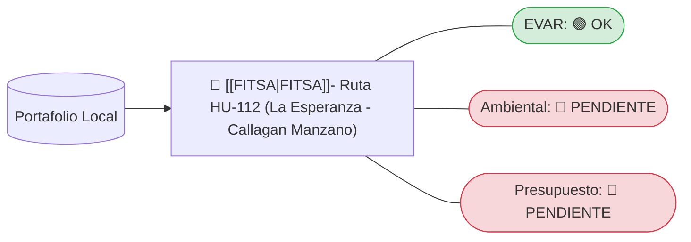

---
tags:
  - Dashboard
  - Proyectos
  - Control
aliases:
  - Monitor de Portafolio
---

# 📊 Dashboard "Live" de Proyectos
*Última actualización: 2026-08-02 14:50:28*

> [!NOTE] 
> Este tablero es generado y actualizado automáticamente por la skill `dashboard-proyectos-live` escaneando el disco duro local.

## 🧭 Mapa de Estado de Expedientes

## 📝 Detalle de Proyectos

| Proyecto | Riesgos (EVAR) | Ambiental | Presupuesto |
| :--- | :---: | :---: | :---: |
| FITSA- Ruta HU-112 (La Esperanza - Callagan Manzano) | ✅ | ❌ | ❌ |
