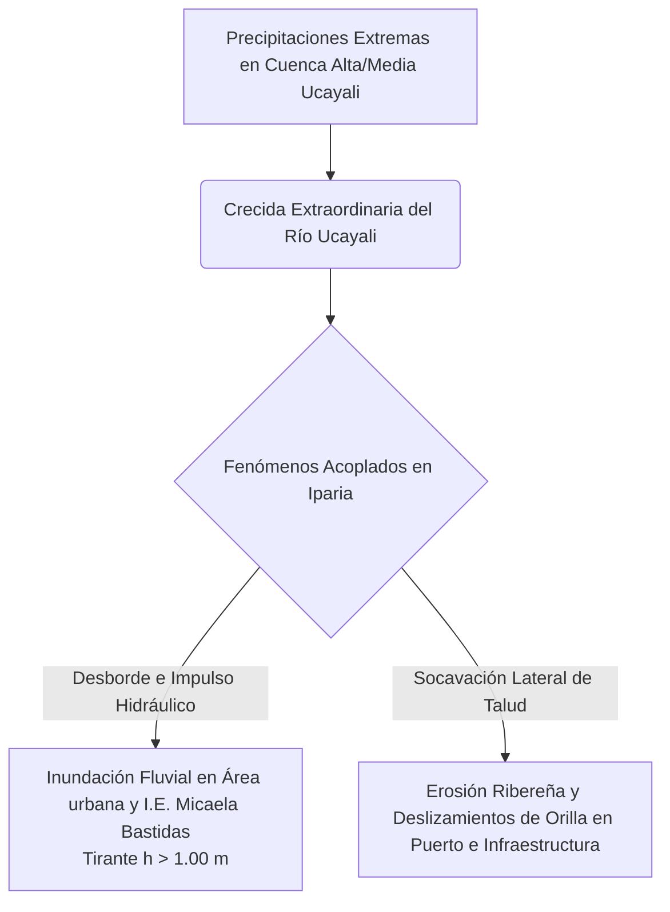

# ANTECEDENTES E HISTORIAL DE INUNDACIONES FLUVIALES Y EROSIÓN DE RIBERAS EN EL DISTRITO DE IPARIA Y ÁREA DE INFLUENCIA DEL PROYECTO

**PROYECTO DE INVERSIÓN PÚBLICA:**
“MEJORAMIENTO Y AMPLIACIÓN DEL SERVICIO DE EDUCACIÓN SECUNDARIA EN I.E. MICAELA BASTIDAS DISTRITO DE IPARIA DE LA PROVINCIA DE CORONEL PORTILLO DEL DEPARTAMENTO DE UCAYALI” – CUI N° 2648571

**[[Gestion_de_Riesgos_EVAR|EVALUACIÓN DEL RIESGO (EVAR)]]:** Inundación Fluvial y Erosión Ribereña
**UBICACIÓN:** Distrito de Iparia, Provincia de Coronel Portillo, Departamento de Ucayali.
**FUENTES DE INFORMACIÓN:** Sistema Nacional de Información para la Respuesta y Rehabilitación (SINPAD - INDECI), Boletín N° 37 Serie C de INGEMMET, Registro de Emergencias COER Ucayali y Datos de Campo SIGRID.

---

## 1. INTRODUCCIÓN Y CONTEXTO HIDRO-GEOMORFOLÓGICO

El distrito de Iparia se localiza en la franja central de la Amazonía peruana, sobre la margen derecha e izquierda del curso medio del **Río Ucayali**. La zona urbana de Iparia y la **Institución Educativa Micaela Bastidas** se emplazan sobre unidades geomorfológicas deposicionales compuestas por **Terrazas Bajas Aluviales (Tb-al)** y **Terrazas Coluvio-Aluviales (TCA)**, caracterizadas por pendientes muy bajas ($< 2^\circ$) y materiales inconsolidados de origen aluvial y orgánico ($Qh-fo$, $Qh-fl$).

La ubicación del proyecto en la cota promedio de 169 m.s.n.m. y a una distancia de aproximadamente **265.25 metros de la orilla del Río Ucayali** condiciona una alta susceptibilidad geomorfológica a dos fenómenos interconectados:
1. **Inundación Fluvial por desborde y anegamiento:** Crecidas estacionales del caudal del Río Ucayali e incapacidad de drenaje de las quebradas locales durante el periodo pluvial (diciembre a abril).
2. **Erosión Fluvial y Socavación de Riberas:** Fuerte dinámica meándrica del Río Ucayali que desestabiliza y erosiona continuamente los márgenes del ribazo.



---

## 2. EVALUACIÓN Y CLASIFICACIÓN DE ZONAS CRÍTICAS (INGEMMET)

De acuerdo con el **Boletín N° 37 Serie C** de la Dirección de Geología Ambiental y Riesgo Geológico del **INGEMMET** ("Riesgos Geológicos en la Región Ucayali"), la región registra un total de 478 eventos de peligro geológico e hidrometeorológico, donde las **inundaciones fluviales (36%)** y la **erosión de riberas (32%)** representan el **68% del total de eventos regionales**.

Dentro del análisis provincial de Coronel Portillo, el **Distrito de Iparia está clasificado formalmente como ZONA CRÍTICA ALTA/MUY ALTA**, debido a la interacción simultánea de desbordes fluviales e inestabilidad de laderas por socavación.

### Cuadro 1: Clasificación de Zonas Críticas en la Provincia de Coronel Portillo
| Provincia | Distrito | Tipo de Peligro Principal | Clasificación INGEMMET | Impacto Principal |
| :--- | :--- | :--- | :---: | :--- |
| **Coronel Portillo** | **Iparia** | **Erosión Fluvial e Inundación** | **Zona Crítica** | Afectación a centros poblados, I.E. e infraestructura portuaria |
| Coronel Portillo | Campo Verde | Inundación por desborde de río | Zona Crítica | Áreas agrícolas y vías |
| Coronel Portillo | Nueva Requena | Inundación por desborde de río | Zona Crítica | Centros poblados ribereños |
| Coronel Portillo | Yarinacocha | Inundación por desborde de río | Zona Crítica | Infraestructura urbana y servicios |

*Fuente: Instituto Geológico, Minero y Metalúrgico (INGEMMET) – Boletín N° 37 Serie C.*

---

## 3. CRONOLOGÍA DETALLADA DE EMERGENCIAS HISTÓRICAS (SINPAD / INDECI / COER)

El análisis histórico de emergencias registradas en el Sistema SINPAD del INDECI refleja una alta recurrencia de desastres hidrometeorológicos en el distrito de Iparia durante los últimos años:

### Cuadro 2: Cronología de Emergencias por Inundación e Erosión en Iparia (2020 - 2025)
| N° | Fecha del Evento | Fenómeno Registrado | Ubicación / Sector Afectado | Descripción del Impacto y Daños Registrados |
| :---: | :---: | :--- | :--- | :--- |
| **01** | **01/12/2025** | **Erosión Fluvial y Deslizamiento Masivo** | Sector Puerto de Iparia | Socavación profunda del ribazo del Río Ucayali provocó el desmoronamiento de la ladera, con hundimiento de embarcaciones. **Cobró la vida de 14 personas**, dejó múltiples desaparecidos y decenas de heridos. |
| **02** | **15/03/2025** | **Inundación Fluvial Generalizada** | Caseríos y CCNN (Puerto Libre, Nuevo Villasol, Utucuro, Puerto Grau, Cumancay) | Crecida extraordinaria del Río Ucayali anegó cientos de viviendas y destruyó áreas agrícolas de pan llevar. |
| **03** | **20/12/2024** | **Inundación por Desborde** | Comunidad Nativa "23 de Setiembre" | Anagamiento estacional de viviendas y áreas comunales por desborde del Río Ucayali. Atención con BAH. |
| **04** | **14/03/2023** | **Erosión Fluvial** | Margen del Río Ucayali (Iparia urbano) | Socavación lateral de la ribera poniendo en riesgo viviendas y vías de comunicación locales. |
| **05** | **09/03/2023** | **Lluvias Intensas e Inundación Pluvial** | Zona urbana de Iparia y sectores bajos | Precipitaciones anómalas colapsaron los sistemas de drenaje pluvial natural, anegando el sector escolar y residencial. |
| **06** | **16/02/2023** | **Inundación Fluvial por Desborde** | Distrito de Iparia (Ribera y área de influencia) | Elevación del tirante de agua por encima de los 1.00 m en zonas bajas del poblado. |
| **07** | **16/02/2023** | **Erosión Fluvial** | Cauce del Río Ucayali | Pérdida de franja de terreno por empuje del caudal. |
| **08** | **29/03/2022** | **Inundación Fluvial** | Área urbana y rural de Iparia | Desborde estacional con afectación a locales públicos y viviendas. |
| **09** | **01/02/2022** | **Inundación Fluvial** | Distrito de Iparia | Crecida de río con afectación de medios de vida. |
| **10** | **24/12/2021** | **Inundación Fluvial** | Distrito de Iparia | Anegamiento por inicio de temporada de lluvias estacionales. |
| **11** | **26/04/2021** | **Erosión Fluvial** | Sector Ribereño de Iparia | Desprendimiento de talud ribereño por vaciado de avenida. |
| **12** | **15/02/2021** | **Inundación Fluvial** | Zona baja distrital | Desborde del Río Ucayali durante el pico de avenida. |
| **13** | **15/02/2020** | **Inundación Fluvial** | Ámbito distrital | Afectación general de viviendas y caminos rurales. |

*Fuente: Elaboración propia a partir de Informes de Emergencia del SINPAD 2.0 (INDECI) y COER Ucayali.*

---

## 4. ANÁLISIS ESPECÍFICO DE IMPACTO EN EL ÁREA DE INFLUENCIA DE LA I.E. MICAELA BASTIDAS

La **I.E. Secundaria Micaela Bastidas** se localiza en la zona urbana de Iparia a aproximadamente 265.25 metros de la ribera del Río Ucayali. El análisis de los antecedentes permite establecer los siguientes comportamientos dinámicos en el área del proyecto:

```mermaid
graph LR
    Sub1[Río Ucayali en Crecida $h > 1.00\text{ m}$] -->|Efecto Barrera Hidráulica| Sub2[Saturación de Terrazas Aluviales y Repose de Quebradas]
    Sub2 -->|Ingreso de Agua| Sub3[Terreno I.E. Micaela Bastidas - Area de trabajo.shp]
    Sub2 -->|Anegamiento Temporal| Sub4[Terreno de Contingencia - Area de contingencia.shp]
```

1. **Mecanismo de Afectación por Inundación Fluvial (Tirante $h > 1.00\text{ m}$):**
   * Durante los meses de febrero y marzo (picos de crecida del Río Ucayali), la elevación del nivel hidrométrico del río actúa como un "efecto represamiento" o barrera hidráulica que impide la descarga de las escorrentías pluviales urbanas.
   * Esto genera inundaciones fluviales acumulativas con tirantes de agua que superan el metro de altura ($h > 1.00\text{ m}$) en las terrazas aluviales bajas donde se emplaza el terreno del proyecto (`Area de trabajo.shp` y `Area de contingencia.shp`).

2. **Riesgo por Erosión y Retroceso de Ribera:**
   * La erosión catastrófica del 1 de diciembre de 2025 en el puerto de Iparia demuestra que el cauce meándrico del Río Ucayali ejerce una socavación activa sobre la terraza de Iparia. Aunque la I.E. se encuentra a ~265 m del borde actual, la velocidad de migración lateral del río exige el seguimiento continuo del frente de socavación.

3. **Vulnerabilidad de la Población Expuesta:**
   * El historial evidencia que las inundaciones interrumpen sistemáticamente el calendario escolar, afectando a los **304 estudiantes de secundaria**, **13 docentes** y a la comunidad escolar colindante de primaria e inicial.

---

## 5. CONCLUSIONES Y RECOMENDACIONES TÉCNICAS PARA EL EXPEDIENTE TÉCNICO (CUI 2648571)

> [!IMPORTANT]
> **RECOMENDACIONES OBLIGATORIAS DE DISEÑO ESTRUCTURAL Y DE MITIGACIÓN:**

1. **Cota de Rasante y Borde Libre:** La cota de piso terminado (NPT) de todas las edificaciones proyectadas en la I.E. Micaela Bastidas debe establecerse por encima del **Nivel de Máxima Avenida Histórica (NMAH)** del Río Ucayali ($h > 1.00\text{ m}$), adicionando un borde libre de seguridad mínimo de $0.60\text{ m}$.
2. **Sistema de Drenaje Pluvial y Fluvial Integrado:** Diseñar un sistema de drenaje pluvial interno con bombas o válvulas anti-retorno (tipo clapeta) para evitar el ingreso del agua del río hacia la escuela durante las crecidas.
3. **Protección del Área de Contingencia:** El predio de contingencia (`Area de contingencia.shp`) debe ser acondicionado con plataformas elevadas temporales para garantizar la seguridad de los alumnos durante la ejecución de las obras.
4. **Cimentaciones Resistentes a la Saturación:** Utilizar zapatas/cimentaciones protegidas contra impermeabilización y corrosión por humedades prolongadas debido a la saturación del nivel freático en la formación $Qh-fo$.

---
*Copia de respaldo guardada en:* `C:\Users\Usuario\OneDrive\Cerebro_Tecnico\01_Proyectos\EVAR_IE_Micaela_Bastidas\Antecedentes_Inundaciones_Iparia.md`


---
**Conexiones Semánticas del Cerebro Digital:**
[[Memoria_Maestra]] | [[01_Proyectos]] | [[02_Metodologias]]

- [[Gestion_de_Riesgos_EVAR]] (Referencia temática: evar)
- [[Absolucion_EVAR_EVAR-IIEE-IPARIA]] (Referencia temática: iparia)

---
## 🌐 Red de Conexiones Semánticas (Cerebro Digital)
- **Hub Central:** [[MOC_Master_Cerebro_Tecnico]] | [[Memoria_Maestra]]
- **Disciplinas:** [[01_Proyectos]] | [[02_Metodologias]] | [[03.Agentes]]
- **Auditores Especializados:** (ninguno registrado — ver [[MOC_Skills_Sistema|MOC_Skills_Sistema]])
