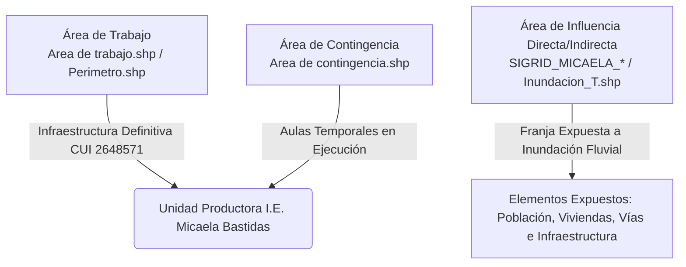

# ELEMENTOS EXPUESTOS DEL PROYECTO - EVALUACIÓN DEL RIESGO (EVAR)

**PROYECTO DE INVERSIÓN:** “MEJORAMIENTO Y AMPLIACIÓN DEL SERVICIO DE EDUCACIÓN SECUNDARIA EN I.E. MICAELA BASTIDAS DISTRITO DE IPARIA DE LA PROVINCIA DE CORONEL PORTILLO DEL DEPARTAMENTO DE UCAYALI”
**CUI N°:** 2648571
**UBICACIÓN:** Distrito de Iparia, Provincia de Coronel Portillo, Departamento de Ucayali.
**NORMATIVA DE REFERENCIA:** Manual para la Evaluación de Riesgos Originados por Fenómenos Naturales (CENEPRED, 2da Edición) y Lineamientos para Infraestructura Educativa.

---

## 1. DELIMITACIÓN DEL ÁREA DE TRABAJO Y ÁREA DE INFLUENCIA

La identificación de los elementos expuestos se realiza a partir de la delimitación cartográfica y espacial de las unidades del proyecto obtenidas de los archivos Shapefile (`.shp`) del Expediente Técnico y de la base de datos espacial SIGRID:

### 1.1 Área de Trabajo (Unidad Productora)
* **Shapefiles de Referencia:** `Area de trabajo.shp` y `Perimetro.shp`.
* **Descripción:** Corresponde al polígono del terreno donde se construirá la nueva infraestructura pedagógica y administrativa del nivel secundaria de la I.E. Micaela Bastidas. Constituye el elemento físico principal del proyecto expuesto a la amenaza de inundación fluvial por desborde del Río Ucayali.

### 1.2 Área de Contingencia
* **Shapefile de Referencia:** `Area de contingencia.shp`.
* **Descripción:** Predio destinado al plan de contingencia del Expediente Técnico, donde se instalarán las aulas temporales y servicios provisionales para dar continuidad a las clases durante la fase de ejecución de la obra.

### 1.3 Área de Influencia
* **Shapefiles de Referencia:** `Inundacion_T.shp`, `SIGRID_MICAELA_Manzanas_Poligonos.shp`, `SIGRID_MICAELA_RedVial_Lineas.shp`, `RIO UCAYALI.shp`.
* **Descripción:** Abarca el ámbito espacial donde los efectos de la inundación fluvial (tirantes de agua $h > 1.00\text{ m}$) afectan a la población escolar, docente, viviendas colindantes, redes viales y servicios comunitarios del centro poblado de Iparia.

---

## 2. IDENTIFICACIÓN Y CUANTIFICACIÓN DE ELEMENTOS EXPUESTOS

De acuerdo con la metodología semicuantitativa del CENEPRED, los elementos expuestos en el área de influencia del proyecto se clasifican en tres dimensiones:

### 2.1 Dimensión Social (Población e Infraestructura Educativa)

Corresponde a la población humana y a los establecimientos educativos susceptibles a sufrir daños físicos o interrupción de actividades ante eventos hidrometeorológicos extremos.

#### Cuadro 1: Elementos Expuestos en la Dimensión Social
| Categoría de Elemento | Tipo de Elemento Expuesto | Cantidad / Unidad | Observaciones / Fuente |
| :--- | :--- | :---: | :--- |
| **Población Estudiantil** | Alumnos Nivel Secundario I.E. Micaela Bastidas | 304 estudiantes | Beneficiarios directos del CUI 2648571 |
| **Población Docente** | Docentes y Personal Administrativo | 13 personas | Personal asignado a la Unidad Productora |
| **Población Referencial** | Población residente en área de influencia | 394 habitantes | Censo de población en zona de inundación |
| **Infraestructura Educativa** | I.E. Secundaria Micaela Bastidas | 01 local escolar | Unidad Productora (Área de Trabajo) |
| **Infraestructura Educativa** | I.E. Primaria N° 64153 - Iparia | 01 local escolar | Local colindante en complejo educativo |
| **Infraestructura Educativa** | I.E. Inicial N° 274 - Iparia | 01 local escolar | Local colindante en área de influencia |

*Fuente: Equipo Técnico EVAR / Estudio de Demanda del Expediente Técnico CUI 2648571.*

### 2.2 Dimensión Económica (Viviendas e Infraestructura Urbana)

Comprende las edificaciones privadas y redes de infraestructura física que soportan las actividades socioeconómicas locales.

#### Cuadro 2: Elementos Expuestos en la Dimensión Económica
| Elemento Expuesto | Descripción / Especificación | Cantidad / Cobertura | Archivo SHP de Soporte |
| :--- | :--- | :---: | :--- |
| **Viviendas y Lotes** | Unidades habitacionales de material rústico/semiurbano | 10 viviendas | `SIGRID_MICAELA_Manzanas_Poligonos.shp` |
| **Red Vial Terrestre (Tramo 1)** | Ruta **UC-112** (Pucallpa - Masisea - Iparia - Atalaya) | 31.66 km (Tramo local) | `SIGRID_MICAELA_RedVial_Lineas.shp` |
| **Red Vial Terrestre (Tramo 2)** | Ruta **UC-115** (Dv. Iparia - Santa Cecilia) | 48.35 km | `SIGRID_MICAELA_RedVial_Lineas.shp` |
| **Infraestructura Fluvial** | Embarcadero / Puerto Fluvial Iparia (Río Ucayali) | 01 punto de acceso | `RIO UCAYALI.shp` |
| **Servicios Básicos** | Redes de agua potable, pozos y alumbrado público | Cobertura local Iparia | DBF Datos Censales SIGRID |

### 2.3 Dimensión Ambiental y Factores Condicionantes del Territorio

Los elementos expuestos interactúan directamente con las características morfodinámicas del suelo:

* **Geomorfología:** Emplazados sobre **Terraza Coluvio-Aluvial (TCA)** y **Terraza Baja Aluvial (Tb-al)**, caracterizados por acumulación de sedimentos y susceptibilidad a inundación pluvial y fluvial.
* **Geología:** Predominio de depósitos de formación orgánica ($Q-fo$) y sedimentos aluviales recientes ($Q-fl$).
* **Pendiente:** Niveles de pendiente muy baja ($< 2^\circ$), lo que dificulta el drenaje natural de las aguas de escorrentía durante las crecidas del Río Ucayali.

---

## 3. RESUMEN DE LA EXPOSICIÓN ANTE EL ESCENARIO DE PELIGRO

| Escenario de Peligro | Parámetro de Evaluación | Elementos en Condición de Riesgo Alto / Muy Alto |
| :--- | :--- | :--- |
| **Inundación Fluvial** | Tirante de agua $h > 1.00\text{ m}$ | • **Infraestructura I.E. Micaela Bastidas** (Área de Trabajo y Área de Contingencia) • **304 estudiantes y 13 docentes** • **10 viviendas unifamiliares** en la franja ribereña • **Acceso vial UC-112** y embarcadero de Iparia |
| **Precipitación Anómala** | Lluvias extremas $RR > 83.53\text{ mm/día}$ | • Colapso de drenaje pluvial interno de la I.E. • Socavación de cimentaciones y erosión lateral de terrazas |

---
*Documento registrado en:* `OneDrive/Cerebro_Tecnico/01_Proyectos/EVAR_IE_Micaela_Bastidas/Elementos_Expuestos_Iparia.md`

---
**Conexiones Semánticas del Cerebro Digital:**
[[Memoria_Maestra]] | [[01_Proyectos]] | [[02_Metodologias]]

- [[Metodologia_EVAR_CENEPRED]] (Referencia temática: cenepred)
- [[Gestion_de_Riesgos_EVAR]] (Referencia temática: evar)
- [[Absolucion_EVAR_EVAR-IIEE-IPARIA]] (Referencia temática: iparia)

---
## 🌐 Red de Conexiones Semánticas (Cerebro Digital)
- **Hub Central:** [[MOC_Master_Cerebro_Tecnico]] | [[Memoria_Maestra]]
- **Disciplinas:** [[01_Proyectos]] | [[02_Metodologias]] | [[03.Agentes]]
- **Auditores Especializados:** (ninguno registrado — ver MOC_Skills_Sistema)
