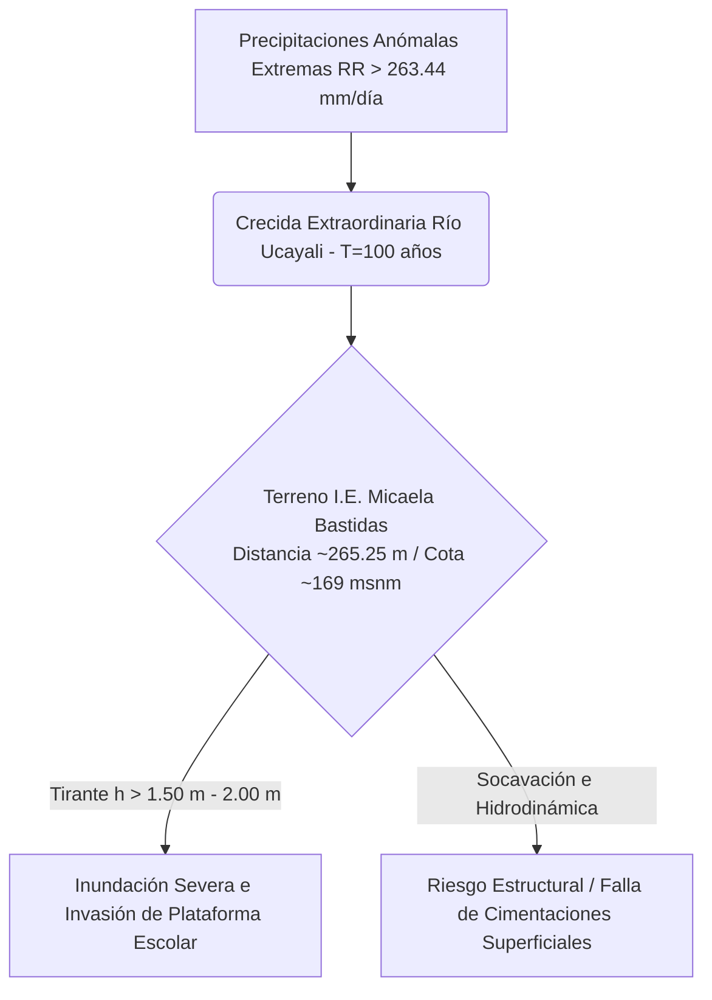
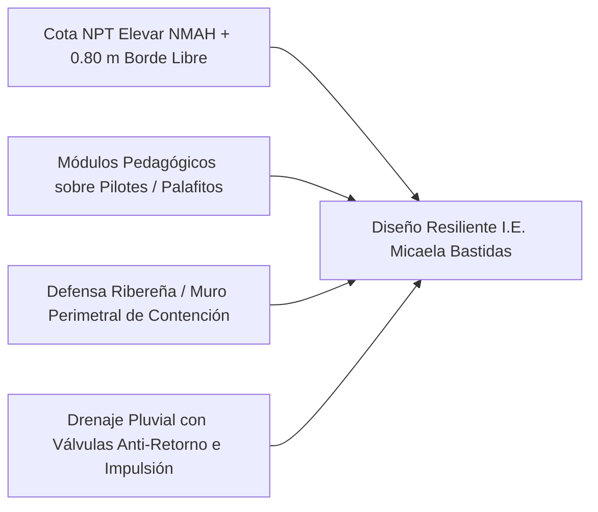

# ANÁLISIS ESCENARIO ANTE EVENTO DE INUNDACIÓN EXTRAORDINARIA ($T = 50 - 100$ AÑOS) EN LA I.E. MICAELA BASTIDAS

**PROYECTO DE INVERSIÓN PÚBLICA:**
“MEJORAMIENTO Y AMPLIACIÓN DEL SERVICIO DE EDUCACIÓN SECUNDARIA EN I.E. MICAELA BASTIDAS DISTRITO DE IPARIA DE LA PROVINCIA DE CORONEL PORTILLO DEL DEPARTAMENTO DE UCAYALI” – CUI N° 2648571

---

## 1. DEFINICIÓN DEL ESCENARIO DE INUNDACIÓN EXTRAORDINARIA

Ante un evento de **Inundación Extraordinaria** originado por la combinación de un **Fenómeno El Niño (FEN) extremo**, lluvias anómalas continuas en la cuenca alta/media del Río Ucayali ($RR > 263.44\text{ mm/día}$) y crecidas con periodos de retorno de $T = 50$ a $T = 100\text{ años}$, las condiciones hidrodinámicas e impactos en el área del proyecto cambian drásticamente:

---

## 2. IMPACTOS FÍSICOS Y OPERATIVOS EN EL ÁREA DE TRABAJO Y CONTINGENCIA

| Componente del Proyecto | Comportamiento ante Inundación Ordinaria ($h \le 1.00\text{ m}$) | Comportamiento ante Inundación Extraordinaria ($h > 1.50\text{ m} - 2.00\text{ m}$) |
| :--- | :--- | :--- |
| **Área de Trabajo (`Area de trabajo.shp`)** | Anegamiento pluvial por falta de drenaje y estancamiento de escorrentía. | **Inundación total por desborde fluvial.** Invasión del nivel de terreno natural. Pérdida de accesibilidad. |
| **Área de Contingencia (`Area de contingencia.shp`)** | Encharcamiento de caminos de acceso y áreas libres. | **Inundación y destrucción de aulas temporales rústicas.** Inhabilitación del servicio educativo. |
| **Población Expuesta (304 Alumnos y 13 Docentes)** | Suspensión temporal de clases por intransitabilidad. | **Riesgo severo para la integridad física,** atrapamiento y evacuación de emergencia por vía fluvial. |
| **Estructuras de Albañilería / Cimentaciones** | Humedad ascendente en sobrecimientos. | **Socavación de bases, fisuramiento por presión hidrostática** y deterioro acelerado por saturación. |

---

## 3. VALORACIÓN DEL NIVEL DE PELIGRO Y RIESGO EXTRAORDINARIO ([[Metodologia_EVAR_CENEPRED|CENEPRED]])

Bajo la matriz jerárquica de Saaty aplicada en la Evaluación del Riesgo (EVAR):

* **Estratificación del Peligro ($P$):** **MUY ALTO ($0.308 \le P \le 0.374$)**.
  * *Descriptor:* Altura de Inundación $h > 1.50\text{ m}$, Precipitación extremada $RR > 263.44\text{ mm/día}$, Formación geomorfológica de Terraza Baja Aluvial ($Tb-al$) y suelo orgánico ($Qh-fo$).
* **Nivel de Vulnerabilidad ($V$):** **MUY ALTA ($0.315 \le V \le 0.385$)**.
  * *Descriptor:* Alta concentración de menores de edad (304 alumnos), inaccesibilidad vial durante la emergencia, escasa infraestructura de contención en el centro poblado.
* **Nivel de Riesgo ($R = P \times V$):** **RIESGO MUY ALTO NO MITIGABLE SIN OBRAS DE INGENIERÍA.**

---

## 4. MEDIDAS ESTRUCTURALES OBLIGATORIAS PARA EL EXPEDIENTE TÉCNICO (CUI N° 2648571)

Para garantizar la **resiliencia y continuidad operativa de la I.E. Micaela Bastidas** ante un evento de Inundación Extraordinaria, el Expediente Técnico DEBE incorporar obligatoriamente las siguientes soluciones de ingeniería:

1. **Definición del Nivel de Piso Terminado (NPT):**
   * El NPT de todas las aulas y ambientes administrativos debe fijarse calculando la cota de la **Máxima Avenida Histórica para $T = 100\text{ años}$** ($NMAH_{100}$) más un **borde libre de seguridad de mínimo $0.80\text{ m}$**.

2. **Edificación Elevada (Pilotes / Palafitos de Concreto Armado):**
   * Construcción de los pabellones en niveles sobreelevados mediante columnas/pilotes o pórticos de concreto armado, dejando la primera planta libre o reservada para áreas inundables no pedagógicas (plazas hundidas de amortiguamiento).

3. **Defensa Ribereña y Muro de Protección Perimetral:**
   * Construcción de un muro de contención perimetral estanco reinforced con geotextil o muro de gaviones en el límite expuesto hacia el Río Ucayali para evitar el ingreso directo de la ola de avenida.

4. **Acondicionamiento del Área de Contingencia:**
   * El predio de contingencia (`Area de contingencia.shp`) debe ser elevado mediante un **relleno masivo compactado** o apoyado sobre plataformas metálicas/madera elevadas para evitar que las aulas temporales sean alcanzadas por las aguas.

5. **Sistema de Bombeo e Impulsión de Aguas Pluviales:**
   * Instalación de **cámaras de bombeo pluvial** equipadas con bombas sumergibles y válvulas de retención (tipo clapeta) que impidan que el Río Ucayali ingrese a través de la red de alcantarillado e inundación del colegio.

---
*Copia en bóveda de Obsidian:* `C:\Users\Usuario\OneDrive\Cerebro_Tecnico\01_Proyectos\EVAR_IE_Micaela_Bastidas\Inundacion_Extraordinaria_Iparia.md`

---
**Conexiones Semánticas del Cerebro Digital:**
[[Memoria_Maestra]] | [[01_Proyectos]] | [[02_Metodologias]]

- [[Metodologia_EVAR_CENEPRED]] (Referencia temática: cenepred)
- [[AHP_Saaty_EVAR_EVAR-IIEE-IPARIA]] (Referencia temática: saaty)
- [[Gestion_de_Riesgos_EVAR]] (Referencia temática: evar)
- [[Absolucion_EVAR_EVAR-IIEE-IPARIA]] (Referencia temática: iparia)

---
## 🌐 Red de Conexiones Semánticas (Cerebro Digital)
- **Hub Central:** [[MOC_Master_Cerebro_Tecnico]] | [[Memoria_Maestra]]
- **Disciplinas:** [[01_Proyectos]] | [[02_Metodologias]] | [[03.Agentes]]
- **Auditores Especializados:** (ninguno registrado — ver MOC_Skills_Sistema)
