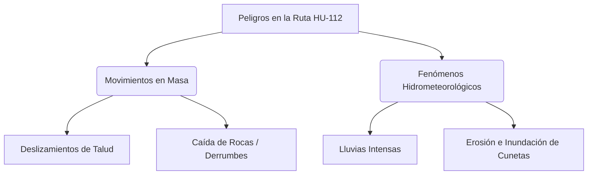

# ⚠️ [[MOC_Master_Gestion_Riesgos|Gestión de Riesgos de Desastres]] (EVAR) - [[MOC_Ruta_HU_112|Ruta HU-112]]

> [!NOTE]
> Esta nota analiza los riesgos originados por fenómenos naturales y geológicos a lo largo de la **[[MOC_Ruta_HU_112|Ruta HU-112 ([[MOC_Ruta_HU_112|La Esperanza - Callagan Manzano]])]]**, fundamentada en los lineamientos técnicos de [[Metodologia_EVAR_CENEPRED|CENEPRED]].
> Enlace principal: [[MOC_Ruta_HU_112|Volver al Panel de Control]] | Metodología: [[Metodologia_EVAR_CENEPRED|EVAR (CENEPRED)]] | Especialista: [[Agente_EVAR_Especialista|Especialista en Riesgos]]

---

## 1. Identificación de Peligros en la Ruta HU-112

La carretera departamental atraviesa una geografía con pendientes pronunciadas y suelos altamente susceptibles a la [[MOC_Geomorfologia_Vial|erosión hídrica]], lo cual configura tres tipos de peligros principales:

### A. Deslizamientos e Inestabilidad de Taludes
Existen sectores críticos entre las progresivas **Km 04+200 y Km 07+800** con [[MOC_Geologia_Vial|taludes de corte]] casi verticales y rocas altamente fracturadas. Las vibraciones producidas por la maquinaria de mantenimiento periódico pueden gatillar desprendimientos menores que comprometen la plataforma.

### B. Lluvias Intensas y Flujo de Detritos (Huaycos)
Las precipitaciones pluviales estacionales en Huánuco (noviembre a abril) superan frecuentemente los límites ordinarios, saturando los suelos de las laderas. Esto incrementa la posibilidad de [[MOC_Geomorfologia_Vial|flujos de detritos]] en las quebradas secas que cruzan la vía, afectando las obras de arte (alcantarillas, pontones) si estas se encuentran obstruidas.

---

## 2. Análisis de Vulnerabilidad de la Infraestructura Vial

La vulnerabilidad del tramo vial [[MOC_Ruta_HU_112|La Esperanza]] - Callagan Manzano se clasifica como **Media-Alta** debido a:
- **Factor Físico:** Falta de cunetas revestidas en zonas de alta pendiente, lo que permite que el agua de lluvia erosione directamente el afirmado de la calzada.
- **Factor de Resiliencia:** Capacidad de respuesta local limitada para la remoción inmediata de escombros en caso de [[MOC_Geologia_Vial|derrumbes]] severos, lo que podría aislar temporalmente a la población de Callagan Manzano.

---

## 3. Matriz de Control y Mitigación de Riesgos

| Sector Crítico (Progresiva) | Peligro Identificado | Nivel de Riesgo | Medidas de Mitigación Propuestas |
| :--- | :--- | :---: | :--- |
| **Km 04+200 - Km 04+800** | [[MOC_Geologia_Vial|Deslizamiento de Talud Superior]] | **Alto** | Reperfilado de talud en zonas críticas y remoción controlada de rocas sueltas previo al afirmado. |
| **Km 09+150 (Cruce Quebrada)**| [[MOC_Geomorfologia_Vial|Flujo de Detritos (Huayco)]] | **Medio** | Descolmatación y limpieza integral de la alcantarilla existente de 36" y colocación de protección de enrocado en la salida. |
| **Todo el tramo (Pendientes)** | [[MOC_Geomorfologia_Vial|Erosión por escorrentía pluvial]] | **Medio** | Perfilado con pendiente transversal (bombeo) del 3% para asegurar la rápida evacuación de aguas a las cunetas. |

---

## 4. Plan de Contingencia ante Emergencias Viales
En coordinación con el consorcio ejecutor y los municipios de La Esperanza y Callagan Manzano, se propone:
1. **Monitoreo de Alerta Temprana:** Suspensión de trabajos con maquinaria pesada en [[MOC_Geologia_Vial|taludes inestables]] durante días de lluvia intensa.
2. **Maquinaria en Retén:** Disposición de un cargador frontal y volquete en el campamento central listos para actuar ante bloqueos de vía por derrumbes.

---
*Análisis desarrollado por [[Agente_EVAR_Especialista|Especialista en Riesgos (EVAR)]] bajo la metodología [[Metodologia_EVAR_CENEPRED]].*

---
## 🔗 Enlaces Puente de Unificación (Cerebro Digital Integrado)
- **Hub Central:** [[MOC_Master_Cerebro_Tecnico]] | [[Memoria_Maestra]]
- **Proyectos Históricos:** [[MOC_Ruta_HU_112]] | [[MOC_Estadio_Ambo]] | [[MOC_Conchumayo_GORE]] | [[MOC_EIA_Estadio_Panao]]
- **Investigación y UDH:** [[MOC_UDH_Academico]] | [[MOC_Tesis_Luz]] | [[Investigacion_Papers]]
- **Metodologías Unificadas:** [[Metodologia_EVAR_CENEPRED]] | [[Metodologia_EVAP_CONESA]] | [[Metodologia_SST_G050]]
- **Auditores y Agentes:** (ninguno registrado — ver MOC_Skills_Sistema)
---
## 🌐 Red de Conexiones Semánticas (Cerebro Digital)
- **Hub Central:** [[MOC_Master_Cerebro_Tecnico]] | [[Memoria_Maestra]]
- **Disciplinas:** [[01_Proyectos]] | [[02_Metodologias]] | [[03.Agentes]]
- **Auditores Especializados:** (ninguno registrado — ver MOC_Skills_Sistema)
