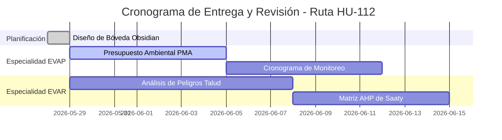

# 🗺️ MOC: FITSA - Ruta HU-112 (La Esperanza - Callagan Manzano)

> [!NOTE]
> Esta nota actúa como el **Mapa de Contenidos (MOC)** y Panel de Control principal de la obra en tu Segundo Cerebro. Aquí se centralizan las especialidades, metodologías y agentes responsables.

---

## 📋 Ficha Técnica del Proyecto

| Parámetro | Detalle |
| :--- | :--- |
| **Proyecto** | Servicio de Mantenimiento Periódico de la Carretera Departamental Ruta HU-112 |
| **Tramo** | La Esperanza - Callagan Manzano |
| **Código Ruta** | HU-112 |
| **Ubicación** | Huánuco, Perú |
| **Entidad** | FITSA (Fondo de Infraestructura de Transporte y Seguridad Vial) |
| **Estado Expediente** | 🟡 En Revisión / Formulación |
| **Coordinador General**| [[Agente_Coordinador|Antigravity (AI Coding Assistant)]] |

---

## 📂 Especialidades del Proyecto (Módulos)

Haz clic en cualquiera de los enlaces para explorar los entregables y el avance detallado de cada especialidad:

### 1. 📝 Generalidades e Ingeniería
- **[[Memoria_Descriptiva|Memoria Descriptiva General]]**: Ficha resumida del tramo, metas físicas y estado situacional de la vía.

### 2. 🌳 Gestión e Impacto Ambiental
- **[[Gestion_Ambiental_y_PMA|Plan de Manejo Ambiental (PMA)]]**: Presupuesto detallado, cronograma y monitoreo de impactos ambientales (residuos, ruido, material particulado).
- *Metodología Relacionada:* [[Metodologia_EVAP_CONESA|Metodología EVAP (CONESA)]]
- *Agente Asignado:* [[Agente_EVAP_Ambiental|Especialista Ambiental]]

### 3. ⚠️ Gestión de Riesgos de Desastres (EVAR)
- **[[Gestion_de_Riesgos_EVAR|Evaluación de Riesgos de Desastres (EVAR)]]**: Identificación de peligros por fenómenos naturales (lluvias intensas, deslizamientos, flujo de detritos) en la ruta.
- *Metodología Relacionada:* [[Metodologia_EVAR_CENEPRED|Metodología EVAR (CENEPRED)]]
- *Agente Asignado:* [[Agente_EVAR_Especialista|Especialista en Riesgos (EVAR)]]

### 4. 👷 Seguridad y Salud en el Trabajo (SST)
- **[[Seguridad_y_Salud_SST|Plan de Seguridad y Salud (SST)]]**: Partidas de EPP, EPC, señalización vial temporal y capacitación de cuadrillas.
- *Metodología Relacionada:* [[Metodologia_SST_G050|Normativa SST G.050 / Ley 29783]]
- *Agente Asignado:* [[Agente_SST_Seguridad|Especialista en SST]]

---

## 🛠️ Panel de Tareas y Control de Entregables

- [x] Estructurar el espacio de trabajo por Proyectos, Metodologías y Agentes en Obsidian.
- [ ] Completar el vaciado de especificaciones del PMA en [[Gestion_Ambiental_y_PMA]].
- [ ] Ejecutar el análisis EVAR del tramo vial La Esperanza - Callagan Manzano en [[Gestion_de_Riesgos_EVAR]].
- [ ] Validar las partidas de EPP contra precios actuales de mercado en [[Seguridad_y_Salud_SST]].

---
*Última actualización: 2026-05-29 | Bóveda integrada y coordinada por [[Agente_Coordinador]].*

---

## 📂 Acceso Directo al Expediente

- [Abrir carpeta del proyecto](file:///C:/Users/DESKTOP/OneDrive/Desktop/FITSA-MANTEN-%20PERIODICO/FITSA-%20Ruta%20HU-112%20(La%20Esperanza%20-%20Callagan%20Manzano))

## ⚙️ Scripts del Ecosistema

- `orquestador_hu112.py` — Orquestador del expediente
- `watcher_supervision_autonomo.py` — Watcher de supervisión

## 🧩 Skills Aplicadas al Expediente

| Skill | Función | Ruta |
| :--- | :--- | :--- |
| `hecras-analyst` | Modelamiento hidráulico | `C:\IA_Proyectos\skills\hecras-analyst` |
| `geotecnia-taludes` | Estabilidad de taludes | `C:\IA_Proyectos\skills\geotecnia-taludes` |
| `auditor-sst` | Plan de Seguridad y Salud | `C:\IA_Proyectos\skills\auditor-sst` |
| `auditor-ambiental` | FITSA Ambiental | `C:\IA_Proyectos\skills\auditor-ambiental` |
| `fitsa_expediente_vial` | Expediente FITSA completo | `C:\IA_Proyectos\skills\fitsa_expediente_vial` |

---
## 🔗 Enlaces Puente de Unificación (Cerebro Digital Integrado)
- **Hub Central:** [[MOC_Master_Cerebro_Tecnico]] | [[Memoria_Maestra]]
- **Proyectos Históricos:** [[MOC_Ruta_HU_112]] | [[MOC_Estadio_Ambo]] | [[MOC_Conchumayo_GORE]] | [[MOC_EIA_Estadio_Panao]]
- **Investigación y UDH:** [[MOC_UDH_Academico]] | [[MOC_Tesis_Luz]] | [[Investigacion_Papers]]
- **Metodologías Unificadas:** [[Metodologia_EVAR_CENEPRED]] | [[Metodologia_EVAP_CONESA]] | [[Metodologia_SST_G050]]
- **Auditores y Agentes:** (ninguno registrado — ver MOC_Skills_Sistema)
- [[AHP_Saaty_EVAR_EVAR-IIEE-IPARIA]] (Referencia temática: ahp)
- [[fitsa_hu112_datos_tecnicos]] (Referencia temática: fitsa)
- [[Absolucion_EVAR_EVAR-IIEE-IPARIA]] (Referencia temática: iparia)

---
## 🌐 Red de Conexiones Semánticas (Cerebro Digital)
- **Hub Central:** [[MOC_Master_Cerebro_Tecnico]] | [[Memoria_Maestra]]
- **Disciplinas:** [[01_Proyectos]] | [[02_Metodologias]] | [[03.Agentes]]
- **Auditores Especializados:** (ninguno registrado — ver MOC_Skills_Sistema)
