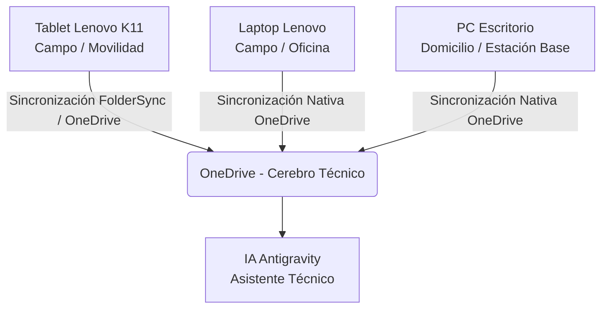

# Flujo de Trabajo Multidispositivo: Cerebro Técnico

Este documento define la arquitectura y el flujo de trabajo sincronizado para operar sin interrupciones entre la **PC de Escritorio**, la **Laptop Lenovo** y la **Tablet Lenovo Tab K11**.

---

## 1. Arquitectura Centralizada (Single Source of Truth)

Toda la información reside en **Microsoft OneDrive**, lo que garantiza que cualquier cambio realizado en un dispositivo se refleje automáticamente en los demás.

* **Bóveda Principal (Obsidian):** `C:\Users\Usuario\OneDrive\Cerebro_Tecnico`
* **Archivos de Proyectos y GIS:** `C:\Users\Usuario\OneDrive\Proyectos\` (ej. [[Gestion_de_Riesgos_EVAR|EVAR]], SHP, Anexos)

---

## 2. Configuración y Roles por Dispositivo

### 📱 Tablet Lenovo Tab K11 (Campo / Trabajo Móvil)
* **Función:** Registro de campo, listas de chequeo EVAR, toma de fotos/evidencias, toma de notas rápidas y lectura de normativas/manuales.
* **Herramientas:**
  * **Obsidian (Android):** Para abrir la bóveda `Cerebro_Tecnico`.
  * **FolderSync (Android):** App gratuita que sincroniza en dos vías la carpeta `OneDrive/Cerebro_Tecnico` con la memoria local de la Tablet.
  * **QField / Input (Opcional GIS):** Para visualización o levantamiento de puntos/polígonos GIS en campo.

### 💻 Laptop Lenovo (Movilidad Híbrida / Trabajo de Campo y Gabinete)
* **Función:** Procesamiento de información de campo, análisis GIS (QGIS/ArcGIS), automatización de reportes EVAR y desarrollo de proyectos en ruta.
* **Herramientas:**
  * **OneDrive Desktop:** Sincronización nativa activa.
  * **Obsidian Desktop:** Apuntando a `C:\Users\Usuario\OneDrive\Cerebro_Tecnico`.
  * **Antigravity AI:** Vinculado a la bóveda y proyectos en OneDrive.

### 🖥️ PC de Escritorio - Domicilio (Estación Base / Gabinete Pesado)
* **Función:** Procesamiento GIS pesado, análisis espacial, revisión final de informes EVAR, generación de mapas y consolidación de la base de datos de conocimiento.
* **Herramientas:**
  * **OneDrive Desktop:** Sincronización nativa activa.
  * **Obsidian Desktop + Antigravity AI:** Misma configuración y acceso a la bóveda única.

---

## 3. Protocolo Diario de Trabajo

1. **Antes de salir a Campo (Laptop / Tablet):**
   * Verificar que OneDrive haya completado la sincronización en la Laptop y Tablet.
   * Abrir Obsidian en la Tablet K11 para confirmar que los formatos o fichas EVAR están listos.

2. **Durante el Trabajo en Campo (Tablet Lenovo K11):**
   * Registrar datos, tomar notas o completar fichas directamente en la nota del proyecto en Obsidian.
   * Al conectarse a Wi-Fi/Datos, FolderSync actualizará las notas automáticamente a OneDrive.

3. **En Gabinete / Oficina (Laptop o PC Escritorio):**
   * Abrir la nota sincronizada del proyecto.
   * Usar **Antigravity AI** para procesar los datos de campo registrados, consolidar tablas EVAR, organizar los Shapefiles (`3. SHP`) y redactar los capítulos del informe.

4. **Sincronización Continua:**
   * Evitar tener el mismo archivo `.docx` o `.shp` abierto simultáneamente en dos computadoras a la vez para prevenir conflictos de edición en OneDrive.

---
*Documento guardado automáticamente en: `Cerebro_Tecnico/02_Metodologias/Flujo_Trabajo_Multidispositivo.md`*

---
**Conexiones Semánticas del Cerebro Digital:**
[[Memoria_Maestra]] | [[01_Proyectos]] | [[02_Metodologias]]

- [[Gestion_de_Riesgos_EVAR]] (Referencia temática: evar)

---
## 🌐 Red de Conexiones Semánticas (Cerebro Digital)
- **Hub Central:** [[MOC_Master_Cerebro_Tecnico]] | [[Memoria_Maestra]]
- **Disciplinas:** [[01_Proyectos]] | [[02_Metodologias]] | [[03.Agentes]]
- **Auditores Especializados:** (ninguno registrado — ver MOC_Skills_Sistema)
