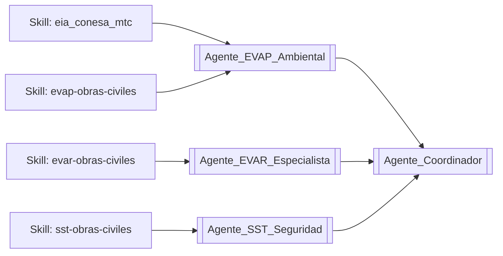

# 🧩 MOC: Sistema de Skills (Claude Code / Antigravity / OpenCode)

> [!NOTE]
> Esta nota técnica es el **Mapa de Contenidos (MOC)** del sistema de *skills* — las capacidades técnicas reales que ejecutan los agentes de este segundo cerebro. Cada [[Agente_Coordinador|Agente]] de la carpeta `03.Agentes` es una *persona* narrativa; las **skills** listadas aquí son el motor técnico real detrás de esa persona.
> Repositorio único (fuente de verdad): `C:\IA_Proyectos\skills\<nombre-skill>\SKILL.md`, enlazado por Junction hacia **tres** destinos: Claude Code (`.claude\skills`), Antigravity (`.gemini\config\skills`) y OpenCode (`.config\opencode\skills`).
>
> ⚠️ **Corregido el 2026-08-13:** aquí decía que "OpenCode lo lee de forma nativa". Es falso — OpenCode tiene su propia carpeta de skills, separada. La misma afirmación errónea vivía en `creador-de-skills`, así que cada skill nueva nacía con un junction de menos.
>
> 📐 **Regla de codificación:** todo `SKILL.md` va en **UTF-8 sin BOM**. El 2026-08-13 se detectó que 64 de 68 tenían BOM (el parser no leía su `description`, así que ninguna se autoactivaba) y 62 tenían mojibake. Ver la sección "Codificación" de `creador-de-skills`.
> Enlace principal: [[Agente_Coordinador|Volver al Agente Coordinador]]

---

## Cómo se relacionan las Skills con los Agentes de este vault

Las skills son el **"cómo"** (procedimiento, normativa, fórmulas, scripts); los Agentes de `03.Agentes` son el **"quién"** narrativo que las invoca dentro del contexto de un proyecto (ej. [[MOC_Ruta_HU_112]]). No dupliques contenido entre ambos — esta nota solo indexa y enlaza, el contenido técnico completo vive en el `SKILL.md` de cada una.

---

## 1. 🌿 Núcleo Ambiental / EIA / Vial (22)

| Skill | Propósito | Nota/Agente relacionado del vault |
| :--- | :--- | :--- |
| `eia_conesa_mtc` | Clasificación de IGA, marco legal SEIA, línea base física/social, matriz Conesa/Leopold, PMA, VEIA, plan de cierre, ERSA, participación ciudadana, fiscalización OEFA | [[Agente_EVAP_Ambiental]] · [[Metodologia_EVAP_CONESA]] |
| `linea-base-biologica` | Muestreo de flora/fauna, índices de diversidad, categorización de especies amenazadas (D.S. 004-2014-MINAGRI, D.S. 043-2006-AG, CITES) | [[Agente_EVAP_Ambiental]] |
| `extractor-linea-base-peru` | Extracción automatizada de datos secundarios (INGEMMET, ANA, MINAM, INEI) vía Playwright | [[MOC_Geologia_Vial]] |
| `evap-obras-civiles` | Diagramas de flujo (Mermaid/Excel) desde una matriz Conesa, cruzando CAPECO | [[Agente_EVAP_Ambiental]] |
| `evar-obras-civiles` | EVAR completo con AHP/Saaty, matriz de riesgo 4×4, informes CENEPRED | [[Agente_EVAR_Especialista]] · [[Metodologia_EVAR_CENEPRED]] |
| `fitsa_expediente_vial` | Auditoría CAPECO, compliance SST/G.050, EVAR de campo, notas Obsidian | [[Agente_EVAR_Especialista]] |
| `fitsa-obras-civiles` | Presupuesto ambiental FITSA (balance hídrico, residuos, efluentes), Excel S10 | [[Agente_EVAP_Ambiental]] |
| `compliance_audit` | Levantamiento de observaciones, compliance legal, coherencia interna de expediente | [[Agente_Coordinador]] |
| `sst-obras-civiles` | Análisis SST completo (NTE G.050, D.S. 005-2012-TR), matriz IPERC, precios EPP | [[Agente_SST_Seguridad]] · [[Metodologia_SST_G050]] |
| `hecras-analyst` | Interpretación de resultados HEC-RAS, número de Froude, memoria de cálculo hidráulico | [[Línea_Base_Hidrológica_Estadio_Panao]] |
| `arcgis-geologia` | Flujo de trabajo ArcMap para cartografía geológica/geomorfológica | [[MOC_Geologia_Vial]] · [[MOC_Geomorfologia_Vial]] |
| `geospatial` | Coordenadas UTM → KML/Shapefile, buffers, áreas (Python/geopandas) | [[MOC_Geologia_Vial]] |
| `orquestador-expedientes` | Ruteo automático de un expediente completo hacia las skills anteriores | [[Agente_Coordinador]] |
| `auditor-ambiental` | Audita, absuelve observaciones **y elabora** estudios ambientales completos (EIA, DIA, PAMA, FITSA) según MINAM/SENACE/OEFA/GORE | [[Agente_EVAP_Ambiental]] |
| `auditor-riesgos` | Audita **y elabora** informes EVAR completos (CENEPRED + AHP/Saaty) | [[Agente_EVAR_Especialista]] · [[Metodologia_EVAR_CENEPRED]] |
| `auditor-sst` | Audita **y elabora** Planes SST (PSST) y matrices IPERC (NTE G.050, Ley 29783, D.S. 011-2019-TR) | [[Agente_SST_Seguridad]] · [[Metodologia_SST_G050]] |
| `auditor-gore-osce` | Levantamiento y absolución de observaciones de entidades peruanas (GORE, OSCE, CENEPRED, MINAM, MTC) sobre un expediente | [[Agente_Coordinador]] |
| `geotecnia-taludes` | Estabilidad de taludes y mecánica de suelos: perfiles estratigráficos, Factor de Seguridad (FoS), empujes, memoria de cálculo geotécnico | [[MOC_Geologia_Vial]] |
| `hecras-surface-to-model` | De superficie topográfica a modelo hidráulico HEC-RAS 6.x completo (1D/2D) | [[Línea_Base_Hidrológica_Estadio_Panao]] |
| `hechms-hydrology-bolivia` | Modelo hidrológico HEC-HMS completo a partir de un DEM (metodología transferible, origen boliviano) | [[Línea_Base_Hidrológica_Estadio_Panao]] |
| `analizador-fotografico-tecnico` | Dictamen técnico por visión multimodal sobre fotografías de campo (ingeniería civil, EVAR, EIA, SST) | [[Agente_Coordinador]] |
| `huella-carbono-construccion` | Cálculo de huella de carbono (kg CO₂-eq) cradle-to-gate con GHG Protocol / ISO 14064 para concretos, partidas y expedientes viales; incluye tabla de factores de emisión con fuentes y redacción del acápite | [[Agente_EVAP_Ambiental]] |

## 2. 📄 Documentos y Datos (9)

| Skill | Propósito |
| :--- | :--- |
| `docx_coautor` | Coautoría de informes Word (EVAP/EIA, expedientes viales, tesis UDH, SST) |
| `excel_sinabrir` | Generación programática de Excel (presupuestos S10, ACU, Gantt, matrices, IPERC) |
| `pdfs` | Extracción/interpretación de PDF (contratos, EVAP, resoluciones, tesis) |
| `pdf-to-markdown` | Conversión íntegra de PDF a Markdown estructurado (Docling AI) |
| `image-processing` | Redimensionar/convertir/optimizar imágenes (Pillow) |
| `firecrawl` | Scraping de portales peruanos (MINAM, MTC, ANA, SENAMHI, SEIA, SEACE...) |
| `context7` | Documentación actualizada de librerías Python/JS antes de generar código |
| `docente_universitario_pptx` | Genera presentaciones de clase (PPTX) para asignaturas universitarias, estructuradas pedagógicamente |
| `metodologia_docencia_ingenieria` | Marco pedagógico, metodológico y de evaluación para asignaturas de Ingeniería |

## 3. 🎓 Investigación y Tesis (9)

| Skill | Propósito | Nota relacionada |
| :--- | :--- | :--- |
| `investigacion-tecnica-tesis` | Biblioteca de 157 libros, curso UCCI de estadística, curso ChatGPT aplicado a investigación | [[MOC_Tesis_Luz]] |
| `revisor-metodologico-riguroso` | Auditoría anti-sesgo de tesis (protocolo de 3 candados) — palabra clave REVISA | [[MOC_Tesis_Luz]] |
| `asistente-tesis-spss` | Redacción de resultados/discusión, interpretación SPSS (p-valor, Alfa de Cronbach) | [[MOC_Tesis_Luz]] |
| `zotero_reference_manager` | Búsqueda bibliográfica, citas APA/ISO 690/MTC, notas de literatura |  |
| `auditor-investigacion` | Motor pesado: revisiones sistemáticas PRISMA 2020, auditoría socrática epistémica, análisis cualitativo, búsqueda RAG de papers con DOI, mindset guard. Encapsula la suite Clo-Author | [[MOC_Tesis_Luz]] |
| `auditor-titulo-investigacion` | Título, planteamiento (Embudo, DQP, CEA), formulación del problema (Matriz Algorítmica), APA 7 y reglamento universitario | [[MOC_Tesis_Luz]] |
| `oraculo_tecnico_rag` | Obliga a buscar en el corpus técnico propio (843 documentos curados) antes de deducir o inventar un concepto | [[Memoria_Maestra]] |
| `tribunal-adversarial-peru` | "Abogado del diablo": intercepta y critica cualquier entregable antes de darlo por bueno (OSCE, MTC, MINAM, CENEPRED, RNE, Ley 29783) | [[Agente_Coordinador]] |
| `preparador-sustentacion` | Simulacro de defensa **oral**: jurado de tesis o evaluador de la entidad. Entra en personaje, contradice en vivo, y después analiza el desempeño y arma la tarjeta de una página. Incluye banco de preguntas derivado de debilidades reales | [[MOC_Tesis_Luz]] |

> **Subagente relacionado:** `director-investigacion` (ver sección 10) coordina estas cuatro más las tres anteriores en un ciclo de 5 fases.
>
> **Diferencia clave entre los dos "adversarios":** `tribunal-adversarial-peru` ataca el **documento** antes de entregarlo; `preparador-sustentacion` te ataca **a ti** defendiéndolo en voz alta. No compiten: el primero blinda el entregable, el segundo blinda al sustentante.

## 4. 🧠 Obsidian / Segundo Cerebro (8)

| Skill | Propósito |
| :--- | :--- |
| `obsidian-loop-workflow` | Bucle autónomo: analiza un archivo/ruta → genera reporte en esta bóveda sin intervención |
| `obsidian_report_generator` | Convierte notas de esta bóveda a Word (.docx) |
| `obsidian_semantic_linker` | Teje enlaces `...` bidireccionales automáticos vía Gemini |
| `notebooklm_vault_bridge` | Empaqueta notas de esta bóveda para los 10 cuadernos de NotebookLM |
| `project_brain` | Recupera precios/rendimientos/definiciones de proyectos anteriores |
| `memoria-acumulativa-proyectos` | Aprendizaje técnico acumulativo de todos los proyectos pasados en `Cerebro_Tecnico\Memoria_Maestra` |
| `ingestor_bibliografico_autonomo` | Daemon: vigila `H:\VIDEO-TUTORIALES` y convierte PDF/DOCX nuevos a Markdown para RAG (unidad externa — conectar el disco antes de usarla) |
| `motor-vectorial-continuo` | Daemon: indexa la bóveda en vectores (SentenceTransformers + FAISS) para que `oraculo_tecnico_rag` busque por significado y no por palabra exacta |

## 5. 📊 Visualización / Generadores HTML (6)

| Skill | Propósito |
| :--- | :--- |
| `architecture-diagram-creator` | Diagramas de arquitectura/estructura de un EIA, tesis o SGA |
| `dashboard-creator` | Dashboards HTML con KPIs ambientales/de obra |
| `flowchart-creator` | Flujogramas de procesos ambientales, EIA/PMA, gestión de riesgos |
| `technical-doc-creator` | Documentación técnica HTML (fichas, memorias, protocolos) |
| `timeline-creator` | Cronogramas/Gantt de obras, EIA, tesis |
| `dashboard-proyectos-live` | **Operador del portafolio** (ampliada 2026-08-14): además del dashboard Mermaid de avance, entrega un **briefing accionable** — observaciones sin absolver con su antigüedad, `memoria.md` desactualizada y versiones múltiples del mismo entregable. Script: `scripts/briefing_operador.py`. Salida en [[Briefing_Portafolio]]. Solo lectura sobre los expedientes |

## 6. ⚙️ Infraestructura / Meta-herramientas (14)

| Skill | Propósito |
| :--- | :--- |
| `github_superpowers` | Versionado Git/GitHub de expedientes, EIA y skills |
| `codebase_memory_mcp` | Mapa persistente de un codebase/carpeta de scripts |
| `superpowers` | Meta-skill: mentalidad, tono y workflow base de todas las demás |
| `creador-de-skills` | Guía para crear/estructurar una nueva skill en el repo canónico |
| `feature-planning` | Descompone una solicitud compleja en un plan de tareas |
| `graphify` | Grafo de conocimiento navegable de un codebase o carpeta de documentos |
| `vigilancia-normativa-peru` | Escanea esta bóveda buscando normas peruanas, las valida contra el MCP `normativa-peru` e inyecta alertas si están derogadas (versión bajo demanda de la tarea programada de la sección 8) |
| `meta-reasoning-cross-harness` | Validación cruzada entre varios arneses de IA (Claude Code, OpenCode, Codex, Antigravity) antes de cerrar un entregable |
| `open-weights-kimi-engine` | Motor de pesos abiertos (Kimi K3 / DeepSeek / Llama 3, vía OpenRouter/Ollama) con ventana de 1M tokens para auditar expedientes gigantes sin fragmentar. `ollama` está instalado en el equipo |
| `cross-platform-artifacts` | Registro persistente de entregables. **Solo Antigravity y OpenCode** — en Claude Code duplicaría los Artifacts nativos |
| `cross-platform-orchestrator` | Orquestador multiagente paralelo. **Solo Antigravity y OpenCode** — Claude Code ya tiene subagentes nativos (ver sección 10) |
| `cross-platform-scheduler` | Planificador de tareas en segundo plano. **Solo Antigravity y OpenCode** — Claude Code ya tiene Scheduled Tasks nativas (sección 8) |
| `agente-remoto-247-tmux` | Ejecución desatendida 24/7 vía tmux. ⛔ **No enlazada en ninguna plataforma:** `tmux` no está instalado en este equipo y no hay servidor remoto — hoy es inejecutable |
| `laravel-skills` | Buenas prácticas PHP/Laravel. ⛔ **No enlazada deliberadamente:** fuera del dominio ambiental; cargaría vocabulario ajeno en el contexto de activación de todas las sesiones |

---

## 7. 🔌 Servidores MCP (1 propio + 6 de terceros)

A diferencia de las skills (instrucciones + scripts que ejecuta el agente), un servidor MCP corre como proceso aparte y expone herramientas estructuradas directamente al modelo.

| Servidor | Propósito | Ruta |
| :--- | :--- | :--- |
| `normativa-peru` | Verifica si una norma peruana (ambiental/SST/vial) sigue vigente o fue derogada — nació del caso real de la R.M. 455-2018-MINAM citada como vigente cuando ya la derogaba la R.M. 00143-2025-MINAM. Herramientas: `verificar_norma`, `listar_normas_por_tema`, `listar_derogadas`, `buscar_actualizacion_web`. | `C:\IA_Proyectos\mcp-servers\normativa-peru\` |

Registrado en `C:\Users\DESKTOP\.claude.json` (alcance global) — **requiere reiniciar la sesión de Claude Code** para conectarse, no se activa en caliente. ✅ **Probado en vivo el 2026-08-13** (consulta real a la R.M. 455-2018-MINAM → responde `derogada`, reemplazada por la R.M. 00143-2025-MINAM).

### MCP registrados por plataforma — **probados con handshake real** (2026-08-13)

No es una lectura de config: se arrancó cada proceso y se habló el protocolo (`initialize` → `list_tools`). **Responden 6 de 6.**

| Servidor | Prueba | Herramientas | Claude Code | Antigravity | OpenCode |
| :--- | :--- | :---: | :---: | :---: | :---: |
| `normativa-peru` | ✅ responde | 4 | ✅ | ✅ | ✅ |
| `arcgis_pro` | ✅ responde | **29** | — | ✅ | ✅ |
| `playwright` | ✅ responde | 24 | ✅ nuevo | ✅ | — |
| `context7` | ✅ responde | 2 | ✅ nuevo | ✅ | — |
| `zotero` | ✅ responde | 11 | — | — | ✅ |
| `browsermcp` | ✅ responde | 12 | — | — | ✅ |
| `qgis` | ⚠️ deshabilitado | — | — | `disabled` | — |
| `firecrawl-mcp` | ⚠️ deshabilitado | — | — | `disabled` | — |
| `deepseek` | ⚠️ deshabilitado | — | — | `disabled` | — |

**Añadidos a Claude Code el 2026-08-13:** `playwright` y `context7`. Las skills `sst-obras-civiles`, `extractor-linea-base-peru` y `context7` los invocan por nombre, pero **no estaban registrados en esa plataforma** — declaraban una capacidad que no existía.

**Los tres deshabilitados, y por qué:** `qgis` requiere QGIS corriendo (además le faltaba el campo `command`, corregido); `firecrawl-mcp` tiene el placeholder `fc-TU_API_KEY_AQUI` en vez de una clave; `deepseek` quedó deshabilitado al retirarle la clave expuesta (ver abajo).

> 🔴 **Secreto retirado (2026-08-13).** La API key de DeepSeek estaba en texto plano y no en un archivo, sino en **tres**: `config\`, `antigravity-backup\` y `antigravity-ide\`. Se sustituyó por un placeholder en los tres y el servidor quedó `disabled`. **Acción pendiente del usuario: rotar la clave** en el panel de DeepSeek — retirarla del disco no la invalida, y estuvo expuesta. Después, pegar la nueva y volver a poner `"disabled": false`. Respaldos `.bak_20260813` junto a cada archivo.
>
> 🔎 **De paso:** `antigravity-backup\mcp_config.json` y `antigravity-ide\mcp_config.json` tienen **JSON malformado** (falta una coma en la línea 54). Es un defecto preexistente; son copias viejas y no las usa el Antigravity activo, pero si alguna vez se restauran, fallarán al cargar.

> 🗺️ **Divergencia de ArcGIS resuelta.** Había **tres** bridges distintos al mismo Add-In de ArcGIS Pro (TCP 27172): `ProgramData\ArcGeekTools\mcp_server` (marzo, 10 herramientas), `.config\opencode\arcgis_pro_bridge.py` (13) y `Documents\MCP-ArcGISPro` (junio, **29 verificadas en la prueba**). Se unificaron las tres plataformas al último. La entrada duplicada `GIS` de OpenCode se retiró: competía por el mismo puerto con `arcgis-pro`.

> ⚠️ **Fallo encontrado y corregido en OpenCode (2026-08-13).** Tres de sus cuatro MCP (`normativa-peru`, `GIS`, `zotero`) estaban declarados con `"type": "stdio"`, `command` como string y un campo `args` — esquema de **otro** cliente. Verificado contra el binario de OpenCode v1.15.13 (struct `McpLocalConfig`), lo válido es `"type": "local"`, `command` como **array** y `environment` en vez de `env`. OpenCode las descartaba en silencio: **nunca funcionaron**, pese a figurar como "registradas".
>
> 📌 **Ambigüedad de config de OpenCode, resuelta.** Coexisten `config.json`, `opencode.json` y `opencode.jsonc`. No hay que elegir: el binario los lee **los tres y los fusiona**, en ese orden (`["config.json","opencode.json","opencode.jsonc"]`). Por eso `arcgis-pro`, que vive solo en `opencode.json`, convive con el resto de `opencode.jsonc`.

## 8. ⏰ Tareas Programadas (1)

| Tarea | Horario | Propósito |
| :--- | :--- | :--- |
| `vigilancia-normativa-peru` | Lunes 08:06 (semanal) | Verifica cada norma "vigente" de `normativa-peru`, corrige `normativas.json` y las skills afectadas si encuentra una derogación/modificación con fuente verificable — con regla anti-alucinación explícita. |

**Con esto queda completo el plan de 3 capas** propuesto tras revisar el curso de Claude Code: Hooks (técnico, siempre activo) → MCP propio (consulta bajo demanda) → Scheduled Task (vigilancia autónoma periódica).

---

## 9. 🚀 Suite Avanzada Claude-Style (3)

Suite implementada para orquestar proyectos masivos emulando las funciones de Codex, MCP Visual y Remote Control. Documentación central: [[Suite_Herramientas_FITSA]].

| Skill | Propósito | Nota relacionada |
| :--- | :--- | :--- |
| `mapeador-visual-expedientes` | Mapeo visual vía HTML/Mermaid de todos los archivos del expediente | [[Suite_Herramientas_FITSA]] |
| `orquestador-fitsa-multisession` | Emula delegación asíncrona a 3 subagentes (Técnico, Riesgos, Ambiental) | [[Suite_Herramientas_FITSA]] · [[fitsa_hu112_datos_tecnicos]] |
| `generador-assets-ingenieria` | Creación de recursos gráficos conceptuales vía Image Generation API | [[Suite_Herramientas_FITSA]] |

---

## 10. 🎓 Subagentes propios de Claude Code (1)

Cuarta capa del sistema, estrenada el 2026-08-13. Hasta entonces `C:\Users\DESKTOP\.claude\agents\` estaba vacía: solo existían los subagentes genéricos de Claude Code.

**Skill vs. subagente:** una *skill* son instrucciones que el modelo principal sigue **en el contexto actual**; un *subagente* corre en **su propia ventana de contexto** y puede paralelizar sin contaminar la sesión principal. Para un trabajo largo (una tesis completa) gana el subagente; para una tarea de un paso, la skill.

| Subagente | Propósito | Nota relacionada |
| :--- | :--- | :--- |
| `director-investigacion` | Coordina el ciclo completo de tesis/artículo/revisión sistemática en 5 fases, con **evaluador distinto del productor** en cada una, protocolo de 3 rondas antes de escalar y estado persistente en `_DIRECCION/estado_investigacion.md`. Despacha las skills de la sección 3 en vez de reimplementarlas | [[MOC_Tesis_Luz]] |

⚠️ Los subagentes son **específicos de Claude Code** (igual que los hooks y las Scheduled Tasks). No hay equivalente verificado en OpenCode ni Antigravity — para esas dos, el papel lo cubre `cross-platform-orchestrator`.

📎 El pipeline de **21 agentes** de `C:\IA_Proyectos\HM_RepositorioINVESTIGACIONES\clo-author\.claude\agents\` (orchestrator, theorist, librarian, strategist, writer, editor, verifier, referees y un crítico por trabajador) **solo se carga si Claude Code se abre dentro de esa carpeta**. Desde cualquier otro proyecto, la vía es la skill `auditor-investigacion`, que encapsula la misma suite.

---

## Reglas de mantenimiento de esta MOC

1. Cuando se **cree, fusione o retire** una skill en `C:\IA_Proyectos\skills\`, actualizar esta tabla en el mismo turno (agregar/quitar fila) — igual que se actualiza el `SKILL.md`.
2. Esta nota **no** debe llegar a contener el procedimiento completo de ninguna skill — solo nombre, propósito en una línea y el enlace al Agente/nota del vault más relacionado. El detalle técnico vive únicamente en el `SKILL.md` correspondiente (evita desincronización entre la bóveda y el repo canónico).
3. Si una skill nueva corresponde claramente a un Agente ya existente en `03.Agentes` (EVAP, EVAR, SST), agregarla a su fila de "Nota/Agente relacionado"; si no corresponde a ningún Agente existente, dejarlo en blanco (no forzar un enlace).
4. **Toda skill nueva necesita TRES junctions** (Claude Code, Antigravity, OpenCode) y su `SKILL.md` en **UTF-8 sin BOM**. Verificar ambas cosas antes de darla por creada — ver `creador-de-skills`.
5. **El chequeo válido de que una skill funciona no es que exista el junction**, sino que su `description` se lea en la lista de skills de la sesión. Si aparece como `---`, la skill está muda: tiene BOM y nunca se autoactivará. Si aparece **solo el nombre, sin descripción**, es el otro fallo: el presupuesto de descripciones está saturado (ver regla 6).
6. **La `description` de cada skill no puede pasar de 200 caracteres** (regla añadida 2026-08-13). Todas las descripciones compiten por un presupuesto compartido: cuando el total llegó a 25 297 caracteres, Claude Code dejó de renderizar la de 19 skills y esas 19 dejaron de autoactivarse, con el archivo perfecto. Se recortaron 55 descripciones y el total bajó a 11 550 (−55%). La `description` dice **cuándo** activar (palabras clave del dominio y verbos gatillo); el **qué hacer** va en el cuerpo del `SKILL.md`. Formato `>-` obligatorio: una descripción plana con `": "` dentro rompe el YAML y degrada la skill en silencio.
7. **No todo lo que está en `C:\IA_Proyectos\skills\` es una skill.** `base-datos-historica-s10` y `watcher-autonomo` son carpetas con un script suelto y **sin `SKILL.md`**: no están enlazadas ni aparecen en esta MOC. Pendiente decidir si se convierten en skills reales o se mueven fuera de `skills\`.

---
*Índice técnico mantenido junto al repositorio canónico `C:\IA_Proyectos\skills\` — última sincronización: **2026-08-14 (71 skills + 1 subagente + 7 MCP)**. Sincronizaciones previas: 2026-08-13 (69 skills), 2026-07-07 (40 skills).*

- [[AHP_Saaty_EVAR_EVAR-IIEE-IPARIA]] (Referencia temática: ahp)
- [[Gestion_de_Riesgos_EVAR]] (Referencia temática: evar)
- [[Gestion_Ambiental_y_PMA]] (Referencia temática: eia)
- [[fitsa_hu112_datos_tecnicos]] (Referencia temática: fitsa)
- [[Seguridad_y_Salud_SST]] (Referencia temática: iperc)
- [[02_Metodologias]] (Referencia temática: s10)
- [[MOC_UDH_Academico]] (Referencia temática: udh)
- [[Absolucion_EVAR_EVAR-IIEE-IPARIA]] (Referencia temática: iparia)

---
## 🌐 Red de Conexiones Semánticas (Cerebro Digital)
- **Hub Central:** [[MOC_Master_Cerebro_Tecnico]] | [[Memoria_Maestra]]
- **Disciplinas:** [[01_Proyectos]] | [[02_Metodologias]] | [[03.Agentes]]
- **Auditores Especializados:** (ninguno registrado — ver MOC_Skills_Sistema)
## 🛠 MONITOR DE AUTOMATIZACIÓN DE CAMPO
- [[Dashboard_Supervision_Maestro]]
- [[Inspeccion_Elite_5Pilares_2026-07-28]]
- [[MOC_Master_Cerebro_Tecnico]]
