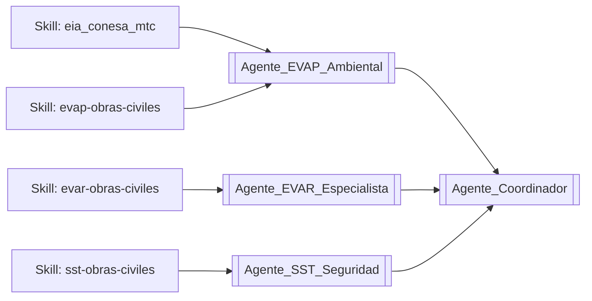

# 🧩 MOC: Sistema de Skills (Claude Code / Antigravity / OpenCode)

> [!NOTE]
> Esta nota técnica es el **Mapa de Contenidos (MOC)** del sistema de *skills* — las capacidades técnicas reales que ejecutan los agentes de este segundo cerebro. Cada [[Agente_Coordinador|Agente]] de la carpeta `03.Agentes` es una *persona* narrativa; las **skills** listadas aquí son el motor técnico real detrás de esa persona.
> Repositorio único (fuente de verdad): `C:\IA_Proyectos\skills\<nombre-skill>\SKILL.md`, enlazado por Junction hacia Claude Code (`.claude\skills`) y Antigravity (`.gemini\config\skills`). OpenCode lo lee de forma nativa.
> Enlace principal: [[Agente_Coordinador|Volver al Agente Coordinador]]

---

## Cómo se relacionan las Skills con los Agentes de este vault

Las skills son el **"cómo"** (procedimiento, normativa, fórmulas, scripts); los Agentes de `03.Agentes` son el **"quién"** narrativo que las invoca dentro del contexto de un proyecto (ej. [[MOC_Ruta_HU_112]]). No dupliques contenido entre ambos — esta nota solo indexa y enlaza, el contenido técnico completo vive en el `SKILL.md` de cada una.

---

## 1. 🌿 Núcleo Ambiental / EIA / Vial (13)

| Skill | Propósito | Nota/Agente relacionado del vault |
| :--- | :--- | :--- |
| `eia_conesa_mtc` | Clasificación de IGA, marco legal SEIA, línea base física/social, matriz Conesa/Leopold, PMA, VEIA, plan de cierre, ERSA, participación ciudadana, fiscalización OEFA | [[Agente_EVAP_Ambiental]] · [[Metodologia_EVAP_CONESA]] |
| `linea-base-biologica` | Muestreo de flora/fauna, índices de diversidad, categorización de especies amenazadas (D.S. 004-2014-MINAGRI, D.S. 043-2006-AG, CITES) | [[Agente_EVAP_Ambiental]] |
| `extractor-linea-base-peru` | Extracción automatizada de datos secundarios (INGEMMET, ANA, MINAM, INEI) vía Playwright | [[MOC_Geologia_Vial]] |
| `evap-obras-civiles` | Diagramas de flujo (Mermaid/Excel) desde una matriz Conesa, cruzando CAPECO | [[Agente_EVAP_Ambiental]] |
| `evar-obras-civiles` | EVAR completo con AHP/Saaty, matriz de riesgo 4×4, informes CENEPRED | [[Agente_EVAR_Especialista]] · [[Metodologia_EVAR_CENEPRED]] |
| `fitsa_expediente_vial` | Auditoría CAPECO, compliance SST/G.050, EVAR de campo, notas Obsidian | [[Agente_EVAR_Especialista]] |
| `fitsa-obras-civiles` | Presupuesto ambiental FITSA (balance hídrico, residuos, efluentes), Excel S10 | [[Agente_EVAP_Ambiental]] |
| `compliance_audit` | Levantamiento de observaciones, compliance legal, coherencia interna de expediente | [[Agente_Coordinador]] |
| `sst-obras-civiles` | Análisis SST completo (NTE G.050, D.S. 005-2012-TR), matriz IPERC, precios EPP | [[Agente_SST_Seguridad]] · [[Metodologia_SST_G050]] |
| `hecras-analyst` | Interpretación de resultados HEC-RAS, número de Froude, memoria de cálculo hidráulico | [[Línea_Base_Hidrológica_Estadio_Panao]] |
| `arcgis-geologia` | Flujo de trabajo ArcMap para cartografía geológica/geomorfológica | [[MOC_Geologia_Vial]] · [[MOC_Geomorfologia_Vial]] |
| `geospatial` | Coordenadas UTM → KML/Shapefile, buffers, áreas (Python/geopandas) | [[MOC_Geologia_Vial]] |
| `orquestador-expedientes` | Ruteo automático de un expediente completo hacia las skills anteriores | [[Agente_Coordinador]] |

## 2. 📄 Documentos y Datos (7)

| Skill | Propósito |
| :--- | :--- |
| `docx_coautor` | Coautoría de informes Word (EVAP/EIA, expedientes viales, tesis UDH, SST) |
| `excel_sinabrir` | Generación programática de Excel (presupuestos S10, ACU, Gantt, matrices, IPERC) |
| `pdfs` | Extracción/interpretación de PDF (contratos, EVAP, resoluciones, tesis) |
| `pdf-to-markdown` | Conversión íntegra de PDF a Markdown estructurado (Docling AI) |
| `image-processing` | Redimensionar/convertir/optimizar imágenes (Pillow) |
| `firecrawl` | Scraping de portales peruanos (MINAM, MTC, ANA, SENAMHI, SEIA, SEACE...) |
| `context7` | Documentación actualizada de librerías Python/JS antes de generar código |

## 3. 🎓 Investigación y Tesis (4)

| Skill | Propósito | Nota relacionada |
| :--- | :--- | :--- |
| `investigacion-tecnica-tesis` | Biblioteca de 157 libros, curso UCCI de estadística, curso ChatGPT aplicado a investigación | [[MOC_Tesis_Luz]] |
| `revisor-metodologico-riguroso` | Auditoría anti-sesgo de tesis (protocolo de 3 candados) — palabra clave REVISA | [[MOC_Tesis_Luz]] |
| `asistente-tesis-spss` | Redacción de resultados/discusión, interpretación SPSS (p-valor, Alfa de Cronbach) | [[MOC_Tesis_Luz]] |
| `zotero_reference_manager` | Búsqueda bibliográfica, citas APA/ISO 690/MTC, notas de literatura |  |

## 4. 🧠 Obsidian / Segundo Cerebro (5)

| Skill | Propósito |
| :--- | :--- |
| `obsidian-loop-workflow` | Bucle autónomo: analiza un archivo/ruta → genera reporte en esta bóveda sin intervención |
| `obsidian_report_generator` | Convierte notas de esta bóveda a Word (.docx) |
| `obsidian_semantic_linker` | Teje enlaces `[[...]]` bidireccionales automáticos vía Gemini |
| `notebooklm_vault_bridge` | Empaqueta notas de esta bóveda para los 10 cuadernos de NotebookLM |
| `project_brain` | Recupera precios/rendimientos/definiciones de proyectos anteriores |

## 5. 📊 Visualización / Generadores HTML (5)

| Skill | Propósito |
| :--- | :--- |
| `architecture-diagram-creator` | Diagramas de arquitectura/estructura de un EIA, tesis o SGA |
| `dashboard-creator` | Dashboards HTML con KPIs ambientales/de obra |
| `flowchart-creator` | Flujogramas de procesos ambientales, EIA/PMA, gestión de riesgos |
| `technical-doc-creator` | Documentación técnica HTML (fichas, memorias, protocolos) |
| `timeline-creator` | Cronogramas/Gantt de obras, EIA, tesis |

## 6. ⚙️ Infraestructura / Meta-herramientas (6)

| Skill | Propósito |
| :--- | :--- |
| `github_superpowers` | Versionado Git/GitHub de expedientes, EIA y skills |
| `codebase_memory_mcp` | Mapa persistente de un codebase/carpeta de scripts |
| `superpowers` | Meta-skill: mentalidad, tono y workflow base de todas las demás |
| `creador-de-skills` | Guía para crear/estructurar una nueva skill en el repo canónico |
| `feature-planning` | Descompone una solicitud compleja en un plan de tareas |
| `graphify` | Grafo de conocimiento navegable de un codebase o carpeta de documentos |

---

## 7. 🔌 Servidores MCP propios (1, en construcción)

A diferencia de las skills (instrucciones + scripts que ejecuta el agente), un servidor MCP corre como proceso aparte y expone herramientas estructuradas directamente al modelo.

| Servidor | Propósito | Ruta |
| :--- | :--- | :--- |
| `normativa-peru` | Verifica si una norma peruana (ambiental/SST/vial) sigue vigente o fue derogada — nació del caso real de la R.M. 455-2018-MINAM citada como vigente cuando ya la derogaba la R.M. 00143-2025-MINAM. Herramientas: `verificar_norma`, `listar_normas_por_tema`, `listar_derogadas`, `buscar_actualizacion_web`. | `C:\IA_Proyectos\mcp-servers\normativa-peru\` |

Registrado en `C:\Users\DESKTOP\.claude.json` (alcance global) — **requiere reiniciar la sesión de Claude Code** para conectarse, no se activa en caliente.

## 8. ⏰ Tareas Programadas (1)

| Tarea | Horario | Propósito |
| :--- | :--- | :--- |
| `vigilancia-normativa-peru` | Lunes 08:06 (semanal) | Verifica cada norma "vigente" de `normativa-peru`, corrige `normativas.json` y las skills afectadas si encuentra una derogación/modificación con fuente verificable — con regla anti-alucinación explícita. |

**Con esto queda completo el plan de 3 capas** propuesto tras revisar el curso de Claude Code: Hooks (técnico, siempre activo) → MCP propio (consulta bajo demanda) → Scheduled Task (vigilancia autónoma periódica).

---

## 9. 🚀 Suite Avanzada Claude-Style (3)

Suite implementada para orquestar proyectos masivos emulando las funciones de Codex, MCP Visual y Remote Control. Documentación central: [[Suite_Herramientas_FITSA]].

| Skill | Propósito | Nota relacionada |
| :--- | :--- | :--- |
| `mapeador-visual-expedientes` | Mapeo visual vía HTML/Mermaid de todos los archivos del expediente | [[Suite_Herramientas_FITSA]] |
| `orquestador-fitsa-multisession` | Emula delegación asíncrona a 3 subagentes (Técnico, Riesgos, Ambiental) | [[Suite_Herramientas_FITSA]] · [[fitsa_hu112_datos_tecnicos]] |
| `generador-assets-ingenieria` | Creación de recursos gráficos conceptuales vía Image Generation API | [[Suite_Herramientas_FITSA]] |

---

## Reglas de mantenimiento de esta MOC

1. Cuando se **cree, fusione o retire** una skill en `C:\IA_Proyectos\skills\`, actualizar esta tabla en el mismo turno (agregar/quitar fila) — igual que se actualiza el `SKILL.md`.
2. Esta nota **no** debe llegar a contener el procedimiento completo de ninguna skill — solo nombre, propósito en una línea y el enlace al Agente/nota del vault más relacionado. El detalle técnico vive únicamente en el `SKILL.md` correspondiente (evita desincronización entre la bóveda y el repo canónico).
3. Si una skill nueva corresponde claramente a un Agente ya existente en `03.Agentes` (EVAP, EVAR, SST), agregarla a su fila de "Nota/Agente relacionado"; si no corresponde a ningún Agente existente, dejarlo en blanco (no forzar un enlace).

---
*Índice técnico mantenido junto al repositorio canónico `C:\IA_Proyectos\skills\` — última sincronización: 2026-07-07 (40 skills).*

- [[AHP_Saaty_EVAR_EVAR-IIEE-IPARIA]] (Referencia temática: ahp)
- [[Gestion_de_Riesgos_EVAR]] (Referencia temática: evar)
- [[Gestion_Ambiental_y_PMA]] (Referencia temática: eia)
- [[fitsa_hu112_datos_tecnicos]] (Referencia temática: fitsa)
- [[Seguridad_y_Salud_SST]] (Referencia temática: iperc)
- [[02_Metodologias]] (Referencia temática: s10)
- [[MOC_UDH_Academico]] (Referencia temática: udh)
- [[Absolucion_EVAR_EVAR-IIEE-IPARIA]] (Referencia temática: iparia)

---
## 🌐 Red de Conexiones Semánticas (Cerebro Digital)
- **Hub Central:** [[MOC_Master_Cerebro_Tecnico]] | [[Memoria_Maestra]]
- **Disciplinas:** [[01_Proyectos]] | [[02_Metodologias]] | [[03.Agentes]]
- **Auditores Especializados:** (ninguno registrado — ver MOC_Skills_Sistema)
## 🛠 MONITOR DE AUTOMATIZACIÓN DE CAMPO
- [[Dashboard_Supervision_Maestro]]
- [[Inspeccion_Elite_5Pilares_2026-07-28]]
- [[MOC_Master_Cerebro_Tecnico]]
