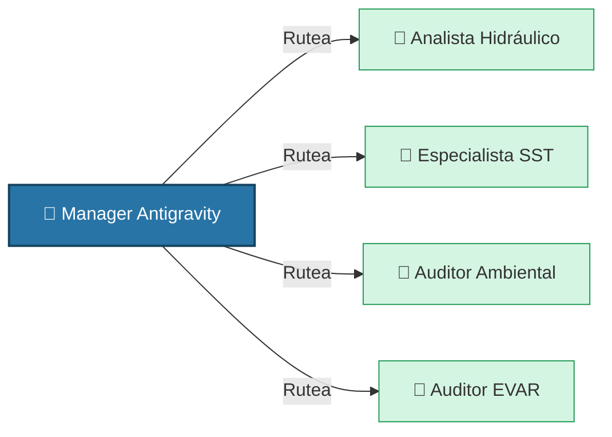

---
cssclasses:
  - dashboard
---

# 🏢 Panel de Control: Oficina de IA

Este panel orquesta y monitorea el estado de los proyectos delegados a los subagentes autónomos.

## 📊 Estado de Proyectos Actuales

| Expediente / Proyecto | Fase Actual | Subagente Asignado | Estado | Progreso |
| :--- | :--- | :--- | :--- | :--- |
| **FITSA - Ruta HU-112** | Generación EVAR | `auditor-riesgos` | 🟢 Completado | [x] 100% |
| **FITSA - Ruta HU-112** | Informe Ambiental | `auditor-ambiental`| 🟡 En Espera | [ ] 0% |
| **Plantilla Piloto** | Extracción TDR | `research` | ⚪ Pendiente | [ ] 0% |

---

## 🤖 Estado de la Fuerza Laboral (Agentes)

## 📋 Registro de Tareas del Tribunal Adversarial
- [x] Validación de márgenes y formato en Word (Paso 1)
- [x] Verificación de rutas absolutas vs relativas en scripts de generación.
- [ ] Auditoría de precios unitarios vs Base de Datos Histórica.
